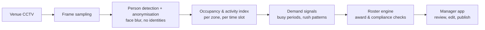

# Architecture

1. **Frame sampling** — a few frames per minute is enough to see how busy a venue is; no need to process full video.
2. **Detection and anonymisation** — people are detected, faces blurred, and only boxes and counts move on.
3. **Occupancy and activity index** — counts per zone (queue, counter, dining) bucketed into time slots and indexed so they can be searched later.
4. **Demand signals** — the index is summarised into expected busy periods for each day of the week.
5. **Roster engine** — builds shifts to meet demand, then checks award rules (minimum shift length, breaks, penalty rates) and venue rules such as a qualified closer each night.
6. **Manager app** — the manager always has the final say before a roster is published.
