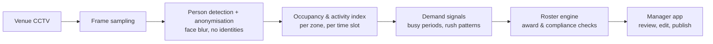

# Architecture

This is the intended design. The public sample code covers occupancy counting and a staffing rule only. The full roster engine and the award and compliance checks are private and still being designed. There is no live CCTV integration, and there is no production deployment.

1. **Frame sampling.** A few frames per minute is enough to see how busy a venue is.
2. **Detection and anonymisation.** People are detected, faces are blurred, and only boxes and counts move on.
3. **Occupancy and activity index.** Counts per zone (queue, counter, dining) are bucketed into time slots and indexed so they can be searched later.
4. **Demand signals.** The index is summarised into expected busy periods for each day of the week.
5. **Roster engine.** Still being designed, and kept private. It is meant to build shifts to meet demand, then check award rules (minimum shift length, breaks, penalty rates) and venue rules such as a qualified closer each night.
6. **Manager app.** The manager always has the final say before a roster is published.
